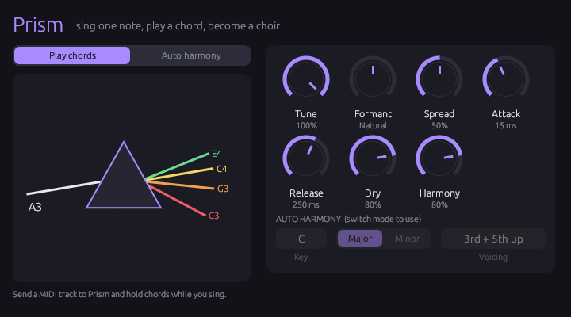
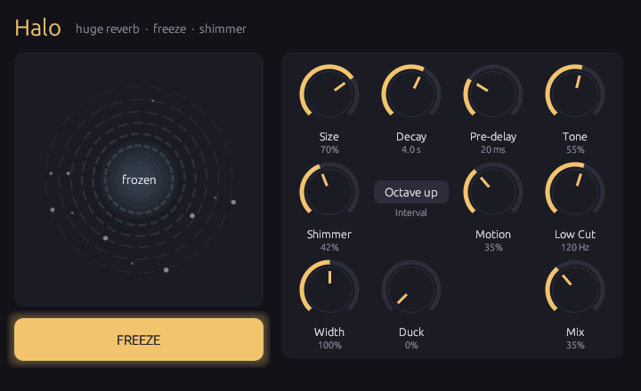
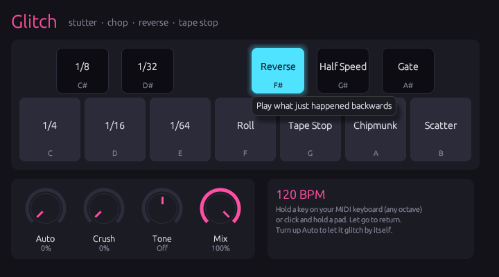

# Olorunns Plugins

Three plugins for Ableton Live, made for experimenting with indie-folk and hyperpop sounds.
They're VST3 plugins, so they work in every edition of Live (Lite, Intro, Standard and Suite).

| | |
|---|---|
| **Prism**: sing one note, hold a chord on your keyboard, and your voice sings the chord (think Bon Iver's "715 - CRΣΣKS"). An auto mode adds in-key harmonies without a keyboard. |  |
| **Halo**: a huge, lush reverb with a **Freeze** button that holds a sound forever (turn a guitar chord into a pad) and **Shimmer** for octave-up sparkle. |  |
| **Glitch**: tempo-synced stutters, reverses, tape stops and chops. Every key on your MIDI keyboard is a different effect, or let it glitch by itself. |  |

## Install on a Mac

1. Download **Olorunns-Plugins-macOS.zip** from the
   [latest build](https://github.com/sharon-olorunns/olorunns-ableton-plugins/releases/tag/latest)
   (you need to be signed in to GitHub), and double-click it to unzip.
2. Open **Terminal** (Cmd+Space, type "Terminal", Enter), paste this line, and press Enter:

   ```sh
   bash ~/Downloads/Olorunns-Plugins-macOS/install.sh
   ```

3. In Ableton Live go to **Settings > Plug-Ins** (called Preferences in older versions), turn on
   **Use VST3 Plug-In System Folders**, and click **Rescan**.

The plugins appear in Ableton's browser under **Plug-Ins > Olorunns**. Drag them onto a track like
any other effect.

**Why the Terminal step?** macOS blocks downloaded plugins that haven't been notarized by Apple
(which needs a paid developer account). The install script copies the plugins to
`~/Library/Audio/Plug-Ins/VST3` and clears that block. To update, download the new zip and run the
same line again.

## Using them in Ableton

### Playing Prism and Glitch from your MIDI keyboard

Prism and Glitch are audio effects that also listen to MIDI. To send them your keyboard:

1. Put the plugin on the audio track you want to affect (your vocal for Prism, anything for
   Glitch).
2. Create a MIDI track (**Cmd+Shift+T**).
3. In the MIDI track's **MIDI To** menu, choose the audio track. A second menu appears below it:
   pick the plugin (**Prism** or **Glitch**). If you can't see these menus, turn on
   **View > In/Out**.
4. Set the MIDI track's **Monitor** to **In** (or arm it) and play.

You can also draw or record MIDI clips on that MIDI track, and the plugin will follow them.

### Prism

- **Play chords** mode: hold a chord while you sing (or while a recorded vocal plays) and each
  note of the chord becomes a copy of your voice. Up to 6 notes.
- **Auto harmony** mode: no keyboard needed. Set **Key** and **Major/Minor** to match your song
  and pick a **Voicing** (3rd up, 3rd + 5th up, 3rd down, Choir, Octaves).
- **Tune**: 100% snaps the harmonies perfectly to pitch for that robotic Bon Iver sound. Lower it
  to keep your natural wobble and vibrato.
- **Formant**: makes the harmony voices sound deeper (−) or smaller and brighter (+).
- **Dry** and **Harmony** set the levels of your original voice and the harmony voices. Turn Dry
  down to 0% to hear only the harmonies.
- **Spread** pans the voices across the stereo field. **Attack** and **Release** shape how
  voices fade in and out when you press and let go of keys.

Prism works best on a solo, dry vocal (one voice, not a whole mix). It needs about 50 ms to
analyse your voice. Ableton compensates for this automatically on playback, but you'll hear the
delay if you monitor yourself through it while recording, so record dry and add Prism afterwards.

### Halo

- **Freeze** holds whatever's in the reverb forever. Play a chord, hit Freeze, and play or sing
  over the pad. To put Freeze on a key or pad: click **Configure** on the Halo device in Ableton,
  click Freeze in the Halo window so it appears on the device, then use MIDI Map mode
  (**Cmd+M**) to map it.
- **Shimmer** feeds an octave-up copy back into the reverb for a glowing, choir-like tail.
  **Interval** changes the shimmer pitch (octave up, fifth up, two octaves up, octave down).
- **Size**, **Decay** (up to 30 s), **Pre-delay**, **Tone** (dark to bright) and **Low Cut** shape
  the space. **Motion** adds slow movement and chorus.
- **Duck** turns the reverb down while you're singing or playing so the words stay clear, and lets
  it bloom in the gaps.
- **Mix**: use about 25-40% on a track, or 100% on a return track.

### Glitch

Every key of the octave is a different effect. All octaves do the same thing, so any keyboard
works. Hold a key to glitch, let go to return to normal.

| Key | Effect | | Key | Effect |
|---|---|---|---|---|
| C | Repeat 1/4 note | | F# | Reverse |
| C# | Repeat 1/8 | | G | Tape stop |
| D | Repeat 1/16 | | G# | Half speed (octave down) |
| D# | Repeat 1/32 | | A | Chipmunk (octave up) |
| E | Repeat 1/64 (buzz) | | A# | Gate (chops in 1/16ths) |
| F | Roll (speeds up every beat) | | B | Scatter (random slices) |

- You can also click and hold the pads on screen.
- **Auto** makes Glitch trigger random effects by itself while the song plays. Try 10-25%.
- **Crush** adds bit-crushing to the glitched sound, **Tone** darkens or thins it, and **Mix**
  blends it with the original.
- Everything locks to your song's tempo.

## For developers

The plugins are written in Rust with [nih-plug](https://github.com/robbert-vdh/nih-plug) and
[egui](https://github.com/emilk/egui).

```
crates/olo_dsp    shared DSP: delay lines, filters, smoothing, pitch shifter
crates/olo_ui     shared look and widgets (knobs, toggles, selectors)
plugins/halo      reverb: 8-channel diffuser + Householder feedback delay network
plugins/glitch    tempo-synced history-buffer effects
plugins/prism     YIN pitch detection + TD-PSOLA harmonizer
```

```sh
cargo test --workspace --release                       # DSP unit tests
cargo xtask bundle -p halo -p glitch -p prism --release   # builds into target/bundled
cargo run -p halo --features standalone --bin halo_standalone   # preview a GUI without a DAW
```

On Linux you'll need the X11/ALSA/JACK development packages listed in
`.github/workflows/build.yml`.

Every push builds the plugins on GitHub Actions. Pushes to the default branch update the
[latest build](https://github.com/sharon-olorunns/olorunns-ableton-plugins/releases/tag/latest),
and pushing a tag like `v1.0.0` creates a versioned release. CI also runs the unit tests and
validates the VST3 plugins with [pluginval](https://github.com/Tracktion/pluginval) at its
strictest level.

## License note

nih-plug's VST3 bindings are GPLv3, so if you share these plugins with others, share them (and
their source) under the GPLv3 too.
