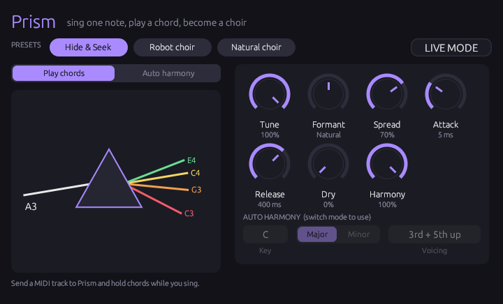
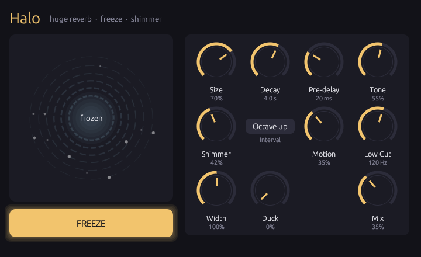
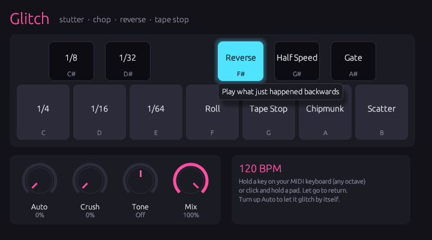
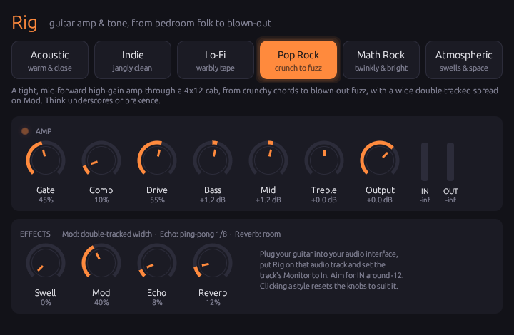
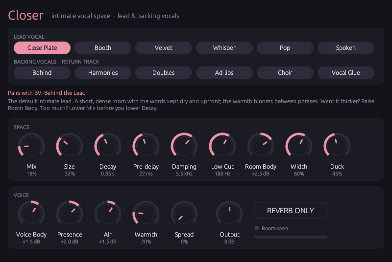

# Olorunns Plugins

Six plugins for Ableton Live, made for experimenting with indie-folk and hyperpop sounds.
They're VST3 plugins, so they work in every edition of Live (Lite, Intro, Standard and Suite).

| | |
|---|---|
| **Prism**: sing one note, hold a chord on your keyboard, and your voice sings the chord (think Imogen Heap's "Hide and Seek" or Bon Iver's "715 - CRΣΣKS"). An auto mode adds in-key harmonies without a keyboard, and Live mode lets you sing through it with almost no delay. |  |
| **Halo**: a huge, lush reverb with a **Freeze** button that holds a sound forever (turn a guitar chord into a pad) and **Shimmer** for octave-up sparkle. |  |
| **Glitch**: tempo-synced stutters, reverses, tape stops and chops. Every key on your MIDI keyboard is a different effect, or let it glitch by itself. |  |
| **Rig**: a guitar amp and tone shaper with six styles (Acoustic, Indie, Lo-Fi, Pop Rock, Math Rock and Atmospheric) for your acoustic and electric guitars. |  |
| **Hearth**: a soft, natural drum kit for folk and indie songs: brushes, felt mallets, shaker, tambourine and a warm wooden room. For when you want percussion that sits gently under the song. | |
| **Closer**: an intimate vocal reverb that adds warmth and body while keeping the voice close and present, never far away or echoey. It has presets for lead vocals and matching presets for backing vocals, so they sit just behind the lead. |  |

## Install on a Mac

1. Download **Olorunns-Plugins-macOS.zip** from the
   [latest build](https://github.com/sharon-olorunns/olorunns-ableton-plugins/releases/tag/latest)
   (you need to be signed in to GitHub), and double-click it to unzip.
2. Open **Terminal** (Cmd+Space, type "Terminal", Enter), paste this line, and press Enter:

   ```sh
   bash ~/Downloads/Olorunns-Plugins-macOS/install.sh
   ```

3. In Ableton Live go to **Settings > Plug-Ins** (called Preferences in older versions), turn on
   **Use VST3 Plug-In System Folders**, and click **Rescan**.

The plugins appear in Ableton's browser under **Plug-Ins > Olorunns**. Drag Halo, Glitch, Prism,
Rig or Closer onto a track like any other effect. Hearth is an instrument: drag it onto an empty MIDI
track.

**Why the Terminal step?** macOS blocks downloaded plugins that haven't been notarized by Apple
(which needs a paid developer account). The install script copies the plugins to
`~/Library/Audio/Plug-Ins/VST3` and clears that block. To update, download the new zip and run the
same line again.

## Using them in Ableton

### Playing Prism and Glitch from your MIDI keyboard

Prism and Glitch are audio effects that also listen to MIDI. To send them your keyboard:

1. Put the plugin on the audio track you want to affect (your vocal for Prism, anything for
   Glitch).
2. Create a MIDI track (**Cmd+Shift+T**).
3. In the MIDI track's **MIDI To** menu, choose the audio track. A second menu appears below it:
   pick the plugin (**Prism** or **Glitch**). If you can't see these menus, turn on
   **View > In/Out**.
4. Set the MIDI track's **Monitor** to **In** (or arm it) and play.

You can also draw or record MIDI clips on that MIDI track, and the plugin will follow them.

### Prism

**For the "Hide and Seek" sound:** click the **Hide & Seek** preset, hold 3-4 note chords on your
keyboard and sing long, steady notes. Only the harmonies come out (Dry is at 0%), so your voice
becomes the chord. Turn on **Live mode** if you're singing through it in real time.

- **Presets**: **Hide & Seek** (harmonies only, perfectly in tune), **Robot choir** (your voice
  plus hard-tuned harmonies) and **Natural choir** (soft, human-sounding backing voices). They're
  starting points: tweak any knob afterwards.
- **Play chords** mode: hold a chord while you sing (or while a recorded vocal plays) and each
  note of the chord becomes a copy of your voice. Up to 6 notes.
- **Auto harmony** mode: no keyboard needed. Set **Key** and **Major/Minor** to match your song
  and pick a **Voicing** (3rd up, 3rd + 5th up, 3rd down, Choir, Octaves).
- **Tune**: 100% snaps the harmonies perfectly to pitch for that robotic Bon Iver sound. Lower it
  to keep your natural wobble and vibrato.
- **Formant**: makes the harmony voices sound deeper (−) or smaller and brighter (+).
- **Dry** and **Harmony** set the levels of your original voice and the harmony voices. Turn Dry
  down to 0% to hear only the harmonies.
- **Spread** pans the voices across the stereo field. **Attack** and **Release** shape how
  voices fade in and out when you press and let go of keys.

Prism works best on a solo, dry vocal (one voice, not a whole mix).

**Live mode** is for singing through Prism in real time, for example to perform or to record the
harmonies as you sing. With it off (the default), Prism looks about 50 ms ahead for the smoothest
result. Ableton compensates for this on playback, so that's best for recorded vocals, but you'd
hear the delay while singing. With Live mode on there's no added delay. Your dry voice comes
straight through and the harmonies follow about 10-20 ms behind (closer for higher voices), like a
hardware harmonizer. Use headphones when singing live so the speakers don't feed back into the
mic.

### Halo

- **Freeze** holds whatever's in the reverb forever. Play a chord, hit Freeze, and play or sing
  over the pad. To put Freeze on a key or pad: click **Configure** on the Halo device in Ableton,
  click Freeze in the Halo window so it appears on the device, then use MIDI Map mode
  (**Cmd+M**) to map it.
- **Shimmer** feeds an octave-up copy back into the reverb for a glowing, choir-like tail.
  **Interval** changes the shimmer pitch (octave up, fifth up, two octaves up, octave down).
- **Size**, **Decay** (up to 30 s), **Pre-delay**, **Tone** (dark to bright) and **Low Cut** shape
  the space. **Motion** adds slow movement and chorus.
- **Duck** turns the reverb down while you're singing or playing so the words stay clear, and lets
  it bloom in the gaps.
- **Mix**: use about 25-40% on a track, or 100% on a return track.

### Glitch

Every key of the octave is a different effect. All octaves do the same thing, so any keyboard
works. Hold a key to glitch, let go to return to normal.

| Key | Effect | | Key | Effect |
|---|---|---|---|---|
| C | Repeat 1/4 note | | F# | Reverse |
| C# | Repeat 1/8 | | G | Tape stop |
| D | Repeat 1/16 | | G# | Half speed (octave down) |
| D# | Repeat 1/32 | | A | Chipmunk (octave up) |
| E | Repeat 1/64 (buzz) | | A# | Gate (chops in 1/16ths) |
| F | Roll (speeds up every beat) | | B | Scatter (random slices) |

- You can also click and hold the pads on screen.
- **Auto** makes Glitch trigger random effects by itself while the song plays. Try 10-25%.
- **Crush** adds bit-crushing to the glitched sound, **Tone** darkens or thins it, and **Mix**
  blends it with the original.
- Everything locks to your song's tempo.

### Rig

Plug your guitar into your audio interface, put Rig on that audio track and set the track's
**Monitor** to **In** so you can hear yourself. Pick a style: clicking one moves all the knobs to
a good starting point for it, then tweak to taste. Aim for the **IN** meter to peak around -12;
if it's much quieter or louder, adjust the input gain on your interface.

| Style | Sound | Inspired by |
|---|---|---|
| **Acoustic** | For acoustic guitar (mic or pickup): fuller body, less pickup "quack", a little air, gentle compression and a small room | Lizzy McAlpine, Phoebe Bridgers, Jake Minch, Tiny Habits |
| **Indie** | Sparkly clean amp that breaks up when you dig in, chorus, slapback echo, bright reverb | Phoebe Bridgers, Dominic Fike |
| **Lo-Fi** | Squashed, boxy and dusty with tape wow & flutter on the Mod knob | Mk.gee, Dijon |
| **Pop Rock** | Tight high-gain amp through a 4x12 cab, crunch to fuzz, wide double-tracked spread | underscores, brakence |
| **Math Rock** | Glassy, compressed clean with headroom for tapping and twinkly riffs, dotted-eighth echo | brakence's midwest-emo side |
| **Atmospheric** | Volume swells, deep slow chorus, dotted-eighth echoes, huge shimmering reverb | Bon Iver, Novo Amor, Porter Robinson |

- **Amp**: **Gate** cuts hum between notes (useful for Pop Rock), **Comp** evens out your playing
  and adds sustain, **Drive** goes from clean to distorted (how far depends on the style),
  **Bass/Mid/Treble** shape the tone, and **Output** sets the final level.
- **Effects**: **Swell** fades each note in, like rolling up your volume knob after picking.
  **Mod**, **Echo** and **Reverb** change character with the style: the line above the knobs
  says what they do in the style you're using. Echoes lock to your song's tempo.
- The styles are tuned by ear to suggest those artists' sounds, not copies of anyone's actual
  gear. Every guitar and pickup is different, so expect to adjust Drive and the tone knobs.

### Closer

Closer is a small, warm room for vocals. Most reverbs push a voice further away. Closer adds body
around it and keeps the singer close, as if they're singing right next to you. Your voice always
stays at full level and the room is added on top, so turning Mix up never makes the vocal quieter.

**Lead vocal:** put Closer on the vocal track **after** your EQ, compressor and de-esser, and
click **Close Plate**. Clicking a preset moves all the knobs to a good starting point for it.
Then tweak to taste.

| Preset | Use it for |
|---|---|
| **Close Plate** | Most lead vocals: short, dense and warm |
| **Booth** | Singer-songwriter, acoustic and lo-fi songs: thick, with almost no tail |
| **Velvet** | R&B and soul: lush between the lines, dry on the words |
| **Whisper** | Soft, breathy, close-up singing |
| **Pop** | A brighter, more forward lead for busy mixes |
| **Spoken** | Podcasts and voice notes |

**Backing vocals:** these presets use the same kind of room as the lead presets, one step further
back: longer, darker and wider, with a dip in the frequencies the lead uses for its words. Each
lead preset says which backing preset it **pairs with**.

| Preset | Use it for | Pairs with |
|---|---|---|
| **Behind** | Most backing vocals | Close Plate, Pop |
| **Harmonies** | Stacked 3rds, 5ths and octaves, glued into one chord | Velvet |
| **Doubles** | Doubles of the lead line, wrapped around it | Booth, Whisper |
| **Ad-libs** | Ad-libs and call-and-response lines | Pop |
| **Choir** | Big oohs, aahs and gang vocals | Close Plate |
| **Vocal Glue** | A **return track** that every vocal is sent to | |

- Put your backing vocal tracks in a group (**Cmd+G**) and put one Closer on the group, or one on
  each part if they need different presets (doubles want more **Spread** than harmonies).
- Pan backing vocal pairs wide, and sit harmonies 6-10 dB and doubles 8-12 dB below the lead.
  You should feel the doubles more than hear them.
- **Shared room:** put Closer on a return track with **Vocal Glue** (it turns on **Reverb Only**).
  Turn the lead's send to about -12 dB and the backing vocals' to about -8 dB. Every voice then
  sounds like it was sung in the same room.

**The knobs**

- **Space**: **Mix** is how much room is added. **Size** stays small (under 40%) for an intimate
  sound. **Pre-delay** is a short gap before the room starts, which keeps the words clear and
  upfront. **Damping** makes the room darker, and **Low Cut** stops it getting muddy. **Room Body**
  adds chest and weight. **Duck** turns the room down while you sing so it only blooms between
  phrases. The meter under Reverb Only shows how much it's ducking right now.
- **Voice** shapes the dry vocal itself: **Voice Body** (low end), **Presence** (brings the words
  forward), **Air** (breath and sparkle), **Warmth** (gentle saturation) and **Spread** (widens
  doubles and stacks; leave it at 0% on a lead).
- Too much reverb? Lower **Mix** before you lower **Decay**.

### Hearth

Hearth is a drum kit you play from MIDI, like a Drum Rack. Drag it onto a MIDI track, then play
your keyboard or pads, or draw notes into a clip. Every sound is synthesized when you hit it, and
each hit is slightly different, so it never sounds like the same sample over and over.

The sixteen pads use the same notes as a Drum Rack (C1 to D#2), so pad controllers and drum MIDI
files line up:

| Note | Sound | | Note | Sound |
|---|---|---|---|---|
| C1 | Kick (felt beater) | | G#1 | Shaker |
| C#1 | Rim (cross-stick) | | A1 | **Swirl** (hold) |
| D1 | Brush tap | | A#1 | Open hat |
| D#1 | Clap | | B1 | Tambourine |
| E1 | Brush slap (accent) | | C2 | Finger snap |
| F1 | Low tom (felt mallet) | | C#2 | Cymbal swell |
| F#1 | Closed hat | | D2 | Foot stomp |
| G1 | High tom (felt mallet) | | D#2 | Brushed ride |

Any other note plays the sound for its key name from the first octave (any C is the kick, any D
the brush tap, any F# the hat), so a small keyboard works too. You can also click the pads on
screen.

- **Swirl** is a brush circling on the snare, the classic jazz and folk brush sound. It keeps
  going for as long as you hold the note, making one circle per beat in time with your song.
  Hold it under a whole bar and tap Brush on 2 and 4.
- **Swell** is a cymbal rolled with soft mallets that grows over two beats. Start it two beats
  before a chorus.
- The closed hat cuts off the open hat, like a real hi-hat.

**Feel**

- **Softness**: from firmer hits to very soft felt and brushes. It slows the attacks, darkens
  the sound and takes the click out of the kick and toms.
- **Tone**: darker or brighter, like moving the mics.
- **Human**: tiny random changes in timing, level, pitch and colour between hits, like a real
  drummer. Turn it to 0% for a tighter, programmed feel.
- **Dynamics**: how much harder hits get louder (and brighter). Lower it if your MIDI keyboard
  is hard to play evenly.
- **Tune** the whole kit up or down, **Room** adds a small wooden room around it, and **Width**
  spreads it out from the drummer's seat (hats on the left, ride on the right).

**Mix**: level knobs for **Kick** (kick and stomp), **Snare** (brushes, swirl, rim, clap and
snap), **Toms**, **Cymbals** (hats, ride and swell) and **Perc** (shaker and tambourine). Turn one
all the way down to switch it off. **Output** sets the overall level.

**Getting the folk sound:** start with just Kick on 1 and 3, Brush on 2 and 4 and Swirl held
underneath, at a velocity of around 60-90. Add Shaker on the off-beats if the song needs to move.
For something even gentler, turn Softness up and put a little more Room on.

## For developers

The plugins are written in Rust with [nih-plug](https://github.com/robbert-vdh/nih-plug) and
[egui](https://github.com/emilk/egui).

```
crates/olo_dsp    shared DSP: delay lines, filters, smoothing, pitch shifter, oversampling, reverb
crates/olo_ui     shared look and widgets (knobs, toggles, selectors)
plugins/halo      reverb: 8-channel diffuser + Householder feedback delay network
plugins/glitch    tempo-synced history-buffer effects
plugins/prism     YIN pitch detection + TD-PSOLA harmonizer
plugins/rig       guitar amp: dynamics, 4x oversampled preamp, tone stack, cab sim, effects
plugins/hearth    drum synth: modal partials + beaded filtered noise per hit, room reverb
plugins/closer    vocal reverb: dense diffusion + 8-line Hadamard FDN, ducking, voice EQ
```

```sh
cargo test --workspace --release                       # DSP unit tests
cargo xtask bundle -p halo -p glitch -p prism -p rig -p hearth -p closer --release   # into target/bundled
cargo run -p halo --features standalone --bin halo_standalone   # preview a GUI without a DAW
```

On Linux you'll need the X11/ALSA/JACK development packages listed in
`.github/workflows/build.yml`.

Every push builds the plugins on GitHub Actions. Pushes to the default branch update the
[latest build](https://github.com/sharon-olorunns/olorunns-ableton-plugins/releases/tag/latest),
and pushing a tag like `v1.0.0` creates a versioned release. CI also runs the unit tests and
validates the VST3 plugins with [pluginval](https://github.com/Tracktion/pluginval) at its
strictest level.

## License note

nih-plug's VST3 bindings are GPLv3, so if you share these plugins with others, share them (and
their source) under the GPLv3 too.
